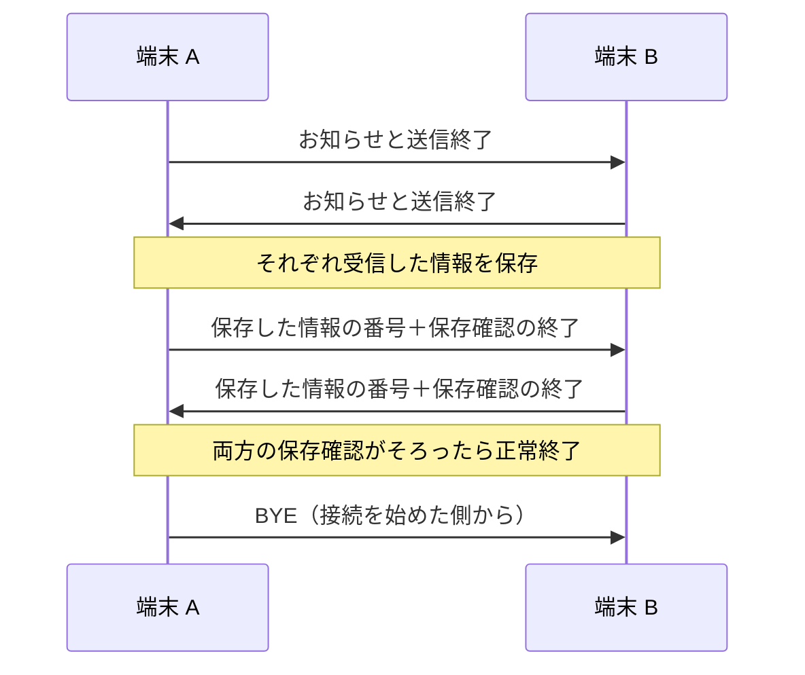

# 大量データを受け取るときの保存・通信仕様

対象: 回覧板 v2.4 / 2026-11-13

この変更は、情報が大量に届いても **本部の記録を残し、保存できなかった情報を成功扱いしない** ためのものです。通信を速くするだけでなく、「何を残すか」「受信をどこで止めるか」「いつ受信成功と数えるか」を決めます。

上限の 1 万件での計測結果と保存・集計・再試行の改善は [負荷確認と改善](12_capacity_measurements.md)、その後の返信待ちの解消は [返信の自動送信](14_reply_outbox.md) に記録する。

## 1. 利用者から見た変化

| 場面 | 修正前に確認した問題 | 変更後の動作 |
|---|---|---|
| 保存が満杯の端末へ一般のお知らせが届く | 古い未確認 SOS も削除対象になった | 有効な未確認 SOS を、一般情報の受信による削除から保護する |
| 本部が安否情報 1,500 件すべてに「受け取りました」を返す | 返信も保存枠を使い、安否一覧が 1,200 件に減った | 本部の受信記録は中継用の枠とは別に保存する。返信しても 1,500 件の記録が残る |
| 端末に保存できない | ログに失敗が出ても、通信は成功扱いになった | 保存失敗として交換を終了する。ホームに保存の問題を表示し、次の交換で再送できるようにする |
| 保存より速く情報が届き続ける | 保存待ちの件数に上限がなかった | 件数とバイト数を制限し、上限に達した交換を終了する。保存済みの続きから再交換する |
| 数千件のお知らせを見る | 一覧カードを作るために、表示範囲外も含め毎回全件分の本文を読み取っていた | 一覧カード用の本文は、表示範囲と直近の先読み範囲に入った行だけ読み取る |

「受け取りました」は、従来どおり **本部が内容を受け付けたという返事** です。救助や対応の完了を意味しません。後述の通信内部の「保存確認」とは別です。

## 2. 保存領域を役割で分ける

| 保存領域 | 目的 | 上限・保管期間 | 満杯になったとき |
|---|---|---|---|
| 中継用 `messages.bin` | 近くの端末へ運ぶ情報を持つ | 最大 3,000 件。各情報の有効期限に従う | 削除可能な情報を整理する。有効な未確認 SOS は容量都合で押し出さない |
| 本部の記録 `reports.bin` | 本部・スタッフが受け取った SOS・安否・困りごとと、その返信を残す | 最大 10,000 報告、現存する記録の符号化後サイズ 64 MiB、最初の受信から 30 日 | 保管期間内の記録を黙って削除せず、保存エラーとして知らせる |
| 受信待ちメモリ | 通信から届き、まだ保存していない情報を一時的に置く | 1 接続と端末全体の両方に上限。§5 参照 | その交換を終了し、待ちを無制限に増やさない |

### 本部の記録

- 本部またはスタッフとして閲覧できるグループの、他の端末から届いた報告を保存する。一般の住民端末には本部用の記録を作らない。
- **報告 1 件と、対応する最新の返信を 1 つの記録にする**。返信が増えても報告の保存枠を圧迫しない。
- 同じ報告を再受信しても重複を作らず、最初の受信時刻と 30 日の保管期限を延長しない。
- 現在の一覧・人数集計には、有効期限内で取り消されていない報告を使う。中継用の有効期限を過ぎた記録は「過去の記録」で確認し、現在の安否集計に混ぜない。
- 本部に記録が残っていても、中継の有効期限は延ばさない。古い SOS を再び緊急情報として広げない。
- 取り消しが届いたら一覧に反映する。スタッフ端末で本文を消す必要がある場合は、本部用記録にも反映する。その場で保存ファイルを書き直し、追記ログの古い記録にも本文を残さない。
- グループを抜けると、そのグループの記録を閲覧できなくなる。記録自体は最初の受信から 30 日で整理される。期間内に再参加し、閲覧する役割があれば再び表示できる。

### 更新時の引き継ぎ

起動時に、既存の `messages.bin` に残っている閲覧可能な報告を本部の記録へ取り込む。本部・スタッフへ昇格したときにも同じ取り込みを行う。更新前に保存上限などで消えた情報は、端末内からは復元できない。

## 3. 中継用の保存が満杯になったとき

保存件数は最大 3,000 件のままとし、参加グループや発信者の役割を問わず、一般情報や新しい SOS の受信によって既存の有効な未確認 SOS を削除しない。期限切れ・古い版など、削除可能なものを先に整理する。保護する情報だけで満杯なら保存上限のエラーを返す。

満杯でも、その SOS を対象とする同じグループのスタッフ・公式の返信は受け付けられる。その返信を保存する操作の中で、対象の SOS だけを削除候補にできる。返信を保存するための空きがなくなり、未確認状態から進めなくなることを防ぐ。

「未確認」は、その SOS に対応する「受け取りました」がまだない状態を指す。返信が届いても救助完了と判断するわけではない。SOS の期限切れ・取り消し・返信によって削除保護の必要がなくなった場合も、本部の受信記録は §2 の保管期間で管理する。

返信として数えるのは、封筒の役割がスタッフ・公式のものに限る。対象の報告が端末にある場合は、同じグループであることも確認する。住民の役割や別グループの返信で SOS の保護を解除しない。この判定は封筒に書かれた役割の検査であり、電子署名による発信者の認証ではない。

## 4. 保存成功の扱い

### 端末内

1. 受信内容を検証し、保存後の状態を準備する。
2. 本部に残す報告なら、先に `reports.bin` に保存する。
3. 中継用 `messages.bin` に保存する。
4. 保存が成功してから、一覧・通知・相手へ送る受信済み一覧を更新する。

保存前のデータを、ほかの処理から「保存済み」として見せない。書き込みに失敗した変更は公開せず、その受信を再試行できるようにする。次の書き込み前には公開済みの状態でファイルを修復し、途中まで書けた失敗データが後続の保存へ混ざらないようにする。

保存枠を空けて新しい情報を入れる操作では、削除が 1 件でもあれば、更新後の全記録を一時ファイルに書いてから元のファイルを置き換える。削除だけを書いた直後にアプリが終了し、元の SOS も新しい返信もなくなる状態を防ぐ。単純な追加は引き続き追記し、複数件はまとめて書き込む。

2 つのファイルへの書き込みは、1 つの原子的な操作ではない。本部記録だけが保存され、中継用の保存が失敗する場合がある。その場合も交換は失敗扱いとし、再受信時の重複排除で処理する。本部記録を先に保存するのは、中継キャッシュの整理によって報告を失わないためである。返信の記録だけが保存された場合も、本部記録から自動送信の候補にする。再起動後も同じ ID を使い、近くの端末の保存確認が取れるまで送信待ちを維持する。利用者による再登録は不要。詳細は [返信の自動送信](14_reply_outbox.md) を参照。

### 端末どうし

新しい版どうしでは、送信が終わっただけでは「相手に保存できた」と判断しない。双方が自分の保存を終えて、保存した情報の番号を交換してから正常終了する。



保存エラー、保存確認の途中での切断、待ち時間超過では、未確認の情報を「相手に保存できた」と数えない。再接続では受信済み一覧を交換し、足りないものを送る。

## 5. 受信待ちと通信量の上限

| 対象 | 上限 | 超えたとき |
|---|---|---|
| 1 接続の保存待ち | 2,048 件かつ 4 MiB | 接続を失敗として終了 |
| 端末全体の保存待ち | 全接続合計 4,096 件かつ 8 MiB | 追加の予約を拒否し、その接続を終了 |
| 1 回にまとめて保存する件数 | 128 件 | 次の保存単位へ分ける |
| 1 接続で受信する MESSAGE | 通常 64 KiB、中継役どうし 1 MiB | 接続を失敗として終了 |
| その他の制御フレームの受信量 | 1 接続 64 KiB | 接続を失敗として終了 |
| 相手の一覧形式の目録 | 3,000 ID | 接続を失敗として終了 |

保存待ちのバイト数は、封筒の送信サイズと展開した本文のサイズに、1 件につき管理用の 128 バイトを加えて数える。実行環境全体のメモリ使用量をそのまま表す数値ではない。保存が済んだ分・破棄した待ちの分は予約を解放する。

中継役どうしの送信は、従来どおり小さい通信単位では 256 KiB に抑える。受信側は相手と通信単位の大きさが異なる場合に備え、1 MiB を上限とする。

通常の相手は送信上限を守る。受信側にも上限を設けることで、上限を守らない相手や保存が遅れている状況でも、保存待ちを増やし続けない。

## 6. 旧版との互換性

| 組み合わせ | 交換方法 | 「この端末から渡した台数」 |
|---|---|---|
| 双方が保存確認に対応 | 保存確認を交換して終了 | 相手が保存を確認した情報についてだけ加算 |
| 片方が旧版 | 従来の送信終了・BYE の手順で交換 | 保存を確認できない送信を加算しない |

旧版との情報交換は継続できるが、旧版からは保存完了の確認を得られない。相手の受信済み一覧で既知になった情報と、今回送っただけの情報は区別する。

ワイヤ上の追加は次のとおり。封筒の形式と HELLO の version は変更しない。

| 項目 | 割り当て |
|---|---|
| HELLO caps bit5 | 保存確認に対応することを示す。双方が立てた場合だけ新しい確認手順を使う |
| フレーム `0x12 STORED` | `flags(u8) + count(u16 LE) + msg_id(i64 LE) × count` |
| STORED の flags bit0 | 最後の確認フレーム。最後は count=0、bit0=1 で終了を示す |
| STORED の分割 | 1 フレーム最大 1,023 ID。確認する ID は、その接続で相手から受け取り保存した情報に限る |

保存確認を受ける側は、今回送ったことのない ID の確認を受け付けない。詳細は [通信プロトコル](02_protocol.md) を参照。

## 7. 大量データの表示と集計

- 一括返信は最大 100 件ずつ保存と通知をまとめ、描画・入力の処理へ戻す。保存完了件数を進捗表示し、終了時は返信の保存件数・自動送信待ち・近くの端末での保存確認を区別する。返信未作成と自動送信待ちは別々に絞り込み、保存済みの返信は自動で送り出す。報告から返信を探すときは、報告の番号で直接引く。同じ一覧の全データを、報告 1 件ごとに探し直さない。
- お知らせ一覧は日付の区切りとメッセージへの参照だけを先に作る。一覧カード用の本文の読み取りとカードの生成は、表示範囲と直近の先読み範囲に限る。未読訓練の件数などの集計では、別途その集計に必要な本文を読む。既読のお知らせは未読訓練の集計で本文を読まない。
- 本部一覧も表示する行だけ画面部品を作る。本文解析・一覧・集計は保存内容・権限・期限が変わるまで再利用する。期限切れの保管記録は、現役の安否集計と分ける。受信 30 日後は、中継ファイルの定期整理前でも本部の履歴・詳細へ戻さない。
- 保存失敗・保存枠不足はホームで知らせる。交換完了の表示だけを見て保存できたと誤解しないようにする。

## 8. 確認すること

| 番号 | 確認条件 | 合格条件 |
|---|---|---|
| B1 | 中継用が満杯で未確認 SOS を含む状態に、一般情報を追加 | SOS が残り、3,000 件の上限も守る |
| B2 | 有効な未確認 SOS だけで満杯 | 一般情報や新着 SOS では押し出さず、保存できないことを返す。その SOS への有効な返信は保存できる |
| B3 | 本部に安否 1,500 件を受信し、全件へ返信して再起動 | 1,500 件の報告と返信状態が復元される |
| B4 | 保存が完了する直前・失敗した直後に受信済み一覧を読む | 未保存データを保存済みとして返さない |
| B5 | 本部記録・中継用の保存をそれぞれ失敗させて再試行 | 成功扱いせず、再試行後に重複なく保存する |
| B6 | 本部記録が件数上限・容量上限に達する | 保管期間内の報告を消さずにエラーを返す |
| B7 | 30 日経過、報告の取り消し、役割変更、更新時の既存データ取り込み | 保管・表示・権限・重複排除が §2 に従う |
| B8 | 保存を止めて大量データを連続受信する | 1 接続の上限で止まり、予約を回収できる |
| B9 | 複数の相手から同時に大量受信する | 端末全体の上限も守る |
| B10 | 保存確認前の切断・保存エラー・不正な確認 ID | 相手への保存成功や渡した台数に加算しない |
| B11 | 新版と旧版を混ぜて交換する | 情報交換を継続でき、未確認送信を確認済みと数えない |
| B12 | 既読のお知らせ 1,000 件を表示して末尾まで移動する | 初期表示では表示・先読み範囲の本文だけを読み、移動先では正しく表示する |
| B13 | 満杯の中継用で、既存情報を削除して新しい情報を保存する途中に処理を中断する | 削除だけが残る状態にならず、旧状態か更新後の状態から復元できる |
| B14 | SOS に対して住民の役割・別グループの返信を受け取る | 有効な返信として数えず、未確認 SOS の保護を維持する |
| B15 | スタッフ端末の本部記録にある報告を取り消す | 現在の画面だけでなく、保存ファイル内の古い記録からも本文が消え、再起動で戻らない |

実装の対応:

| 範囲 | 実装 |
|---|---|
| 保存の確定、SOS 保護、返信の索引 | [`message_store.dart`](../lib/mesh/message_store.dart)、[`store_file.dart`](../lib/mesh/store_file.dart) |
| 本部の記録と画面への公開 | [`report_inbox.dart`](../lib/mesh/report_inbox.dart)、[`app_controller.dart`](../lib/app/app_controller.dart) |
| 保存確認、受信制限、再接続 | [`frames.dart`](../lib/core/frames.dart)、[`sync_session.dart`](../lib/mesh/sync_session.dart)、[`mesh_node.dart`](../lib/mesh/mesh_node.dart) |
| 大量一覧の表示 | [`home_screen.dart`](../lib/ui/screens/home_screen.dart)、[`reports_screen.dart`](../lib/ui/screens/reports_screen.dart) |

自動テスト:

- [`store_reliability_test.dart`](../test/mesh/store_reliability_test.dart): B1・B2・B4・B5 の中継保存部分、B13・B14。
- [`report_inbox_test.dart`](../test/mesh/report_inbox_test.dart): B3・B6・B7・B15、本部記録と中継用保存の間で失敗した場合の再試行。
- [`report_inbox_screen_test.dart`](../test/ui/report_inbox_screen_test.dart): 本部記録だけが保存された返信の再起動後の再試行、期限切れの記録と現在の一覧の分離、大量一覧の表示範囲に応じたカード生成。
- [`receive_reliability_test.dart`](../test/mesh/receive_reliability_test.dart): B5 の通信部分・B8〜B11。
- [`home_bulk_test.dart`](../test/ui/home_bulk_test.dart): B12、ホームの保存失敗表示。

全体の確認コマンド:

```sh
flutter analyze
flutter test
```

自動テストは保存・通信の条件を再現するもの。低性能スマートフォンでの受信中の操作、実機での空き容量不足、複数台の BLE 接続、電池消費は別途実機で確認する。従来の Mac → iPhone の「1,500 件を 28 秒」という測定値は、今回の変更後の速度保証としては使わない。
