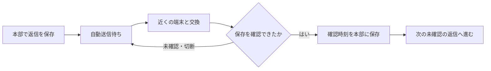

# 大量の返信を自動で送り出す仕組み

対象: 回覧板 / 2026-11-13

本部で「受け取りました」を返すと、まず返信を本部の記録に保存する。**中継用の 3,000 件の枠から外れても、近くの端末が保存したと確認できるまで、自動送信の候補に残す。** 一度保存した返信を、利用者がもう一度作り直す必要はない。

これは「近くの端末に渡せた」ことの確認であり、住民本人への到着確認や救助・対応完了の確認ではない。

## 1. これまでの問題と変更

本部の報告と返信は 10,000 件まで保存できる一方、通信は中継用の 3,000 件だけを送信候補にしていた。[前回の負荷計測](12_capacity_measurements.md#4-計測時の制約とその後の改善)では、保存した返信のうち 7,116 件が中継枠から外れた。一括で再登録しても枠を入れ替えるだけになり、全件を送り出せるとは限らなかった。

今回から、本部に保存した未確認の返信も送信候補に含める。SOS・緊急情報の優先を保ち、その後で未確認の返信を、受渡し済みの返信の再送より先に送る。同じ返信が中継枠にもあれば、同じ ID を二重に送信候補へ入れない。



## 2. 画面での意味

| 状態 | 意味 |
|---|---|
| まだ返事をしていない | 本部・スタッフの返信がまだ作られていない |
| 自動送信待ち | この端末で返信を保存済み。近くの端末の保存確認を待っている |
| 近くのスマホが返信を保存した | 少なくとも一台が返信を持つことを確認した |
| 返信の送信期限が切れた・未確認 | 確認のないまま返信の有効期限を過ぎた。待ち件数には数えない |

「自動送信待ち」は独立して絞り込める。報告の有効期限が切れても、返信の有効期限内ならこの一覧に残る。過去の安否を現在の人数集計へ戻さない。一括返信の対象は返信未作成の報告だけとし、保存済みの返信は自動処理に任せる。

## 3. 保存と確認

- `reports.bin` の各報告に、最新の返信と `ackHandedAt`（近くの端末の保存確認時刻）を保存する。返信 ID が変わったら、その新しい返信は未確認から始める。
- `ackHandedAt` のない旧データも読み込める。過去の受渡しを推測せず、期限内の自分の返信は未確認として再送の対象にする。
- 確認として使うのは、相手の正確な ID 一覧、今回の送信に対応した `STORED`、相手から実際に受け取った同じ返信。Bloom 要約の「持っていそう」という判定だけでは待ちを解除しない。未確認の返信は、Bloom が一致しても通常送信で再確認する。
- 途中で切れても、既に受け取った有効な保存確認は使える。確認できなかった返信は残す。従来の「この端末から渡した台数」は、引き続き正常終了した交換の送信確認だけを数える。
- 本部の確認記録はディスク保存が成功してから公開する。失敗した場合は送信待ちを維持し、次の接触で同じ ID を再確認する。
- 本部への返信保存が成功し、中継ファイルの保存だけが失敗した場合も、本部の記録から送信できる。返信を作る操作自体の保存エラーは表示する。
- アプリの再起動後も確認済みと未確認の区別を復元する。報告の再受信や同じ返信の再受信で、確認を忘れたり保存期限を延ばしたりしない。

旧版には `STORED` がない。送っただけでは確認済みにせず、後の交換で相手の正確な一覧などから同じ ID を確認できた場合に進む。Bloom 要約だけを返す旧版から正確な ID 確認が得られない場合は、実際に送れていても送信待ちを維持する。

## 4. 大きな交換の区切り

通常の送信上限 64 KiB、中継役どうしのバイト上限、受信側の保存待ち上限は維持する。それに加え、送信側も先出し分を含めて **1 接続 2,048 件・受信時の見積もり 4 MiB 以内**で区切る。受信時の見積もりはワイヤデータ、展開済み本文、1 件あたり管理用 128 バイトの合計。

中継役どうしでは小さな返信を大量に詰め込めるため、バイト上限だけを守っても受信側の件数上限を超える場合があった。保存確認できる量で `MESSAGES_END(more)` を送り、残りは次の交換へ進める。端末全体の保存待ちは、引き続き全接続合計 4,096 件・8 MiB に制限する。

## 5. 維持する制限

- 本部記録は 10,000 件 / 64 MiB、報告受信から 30 日。中継用は 3,000 件。上限を無制限には増やさない。
- 返信は元の報告の中継期限 + 24 時間、作成から最大 72 時間。自動送信待ちでも期限は延ばさない。
- 取り消された報告、保管期限切れ、返信自体の期限切れ、閲覧権限のないグループは、本部記録からの送信候補にしない。
- 一台が保存した後にその端末がデータを削除・紛失したり、保存枠から押し出したりしても、住民本人への到着を保証する仕組みではない。本部の返信記録は保管期間中残るが、確認済みの全返信を本部の記録から繰り返し再配布する機能は今回含まない。中継枠に残るコピーは従来どおり広がる。
- BLE の接触時間、発見までの遅れ、画面オフ、電池消費は別の条件。[実測と歩行中の試算](13_ble_encounter_estimates.md)を参照。今回のソフトウェア試験をスマートフォンの BLE 実測として扱わない。

## 6. ローカルでの確認

CI は追加しない。2026-11-13 の最終確認は静的解析の指摘なし、通常テスト **437 件成功**。以下の回帰テストを含む。

| テスト | 確認すること |
|---|---|
| [reply_outbox_controller_test.dart](../test/mesh/reply_outbox_controller_test.dart) | 1 万件を 3,000 件の受信枠へ順に渡す。途中再起動後も全 ID の保存確認まで進む。中継保存失敗、確認記録保存失敗から回復する |
| [pending_outgoing_test.dart](../test/mesh/pending_outgoing_test.dart) | 送信候補の重複排除・優先順・期限・原本、再接続判定、正確な確認と Bloom の区別、2,048 件での分割 |
| [reply_outbox_persistence_test.dart](../test/mesh/reply_outbox_persistence_test.dart) | 確認状態の永続化、旧形式、同一 ID の重複、古い返信への遅延確認、取消・期限・権限、容量や保存失敗 |

```sh
flutter analyze
flutter test
```

1 万件の通信試験では仮想時計・模擬通信・メモリ内の保存先を使う。受信端末が一度に全件を保持するという意味ではなく、**全 ID をそれぞれ保存し、本部が確認できたこと**を検証する。実機での所要秒数や最終受信者への到達率は、この試験からは算出しない。

実ファイルの保存試験も 1,000 件・10,000 件の両方で成功。10,000 件では受信・保存 425 ms、一括返信保存 268 ms、再起動の読み込み 96 ms だった（同じ Mac の単回測定、四捨五入）。[生データ](measurements/2026-11-13-outbox-capacity.json)には実行条件と送信待ちの新しい定義を併記した。通信前なので送信待ちは 10,000 件であり、全件が保存済みでもまだ近くへの保存確認はない状態を表す。
